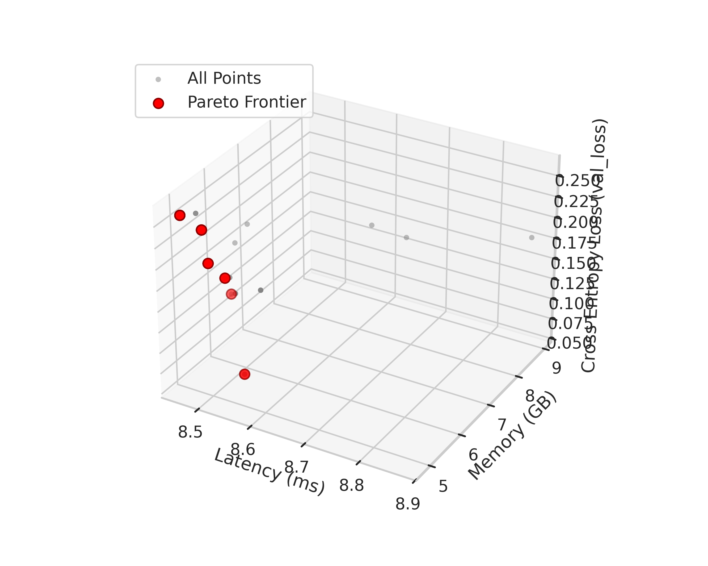
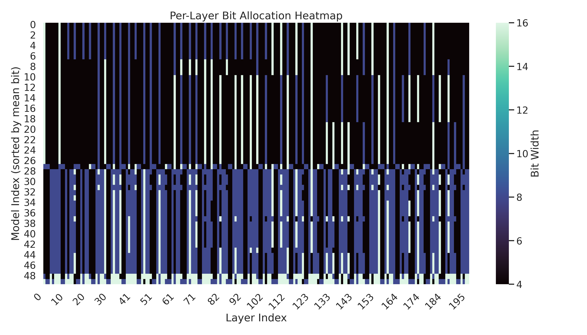

# AutoLLMTuner

NSGA-II search over mixed-precision quantization for large language models.
Instead of quantizing a whole model to one bit-width, AutoLLMTuner searches
for a *per-layer* bit-width allocation — 4, 8, or 16 bits for each linear
layer — that trades off accuracy, memory, and latency, and returns the
Pareto frontier of allocations so you can pick the trade-off your hardware
actually needs.

The headline result on Qwen2.5-7B-Instruct: a frontier configuration at
**5.51 GB that answers 94% of MATH-500 problems**, and a **4.83 GB**
configuration that still holds 74% — against a 12.49 GB FP16 model.

## How it works

**The genome.** One gene per quantizable linear layer: Qwen2.5-7B has 196
of them (28 layers × 7 projections). Two structural constraints shrink the
search: all Q/K/V projections share one bit-width across every layer, and
the MLP gate/up projections are tied the same way, leaving 58 independent
decisions out of a 3^58 ≈ 5×10^27 space. Embeddings, the LM head, and
layernorms are never quantized. The constraints live in
`configs/quant_units.yaml` and are enforced by `GroupTies.repair`, so every
individual the search breeds is legal by construction.

**The three objectives.** For each candidate allocation:

1. **Validation loss** — the quantized model is evaluated on MATH-500
   (HuggingFaceH4/MATH-500, first 50 problems). The current evaluator
   rebuilds each layer in place from cached FP16 weights with bitsandbytes
   (NF4 for 4-bit, `Linear8bitLt` for 8-bit) and reports teacher-forced
   cross-entropy loss. An earlier generate-and-grade evaluator is described
   under [Results](#results).
2. **Memory** — Σ(parameter count × bits / 8) from the per-layer parameter
   counts in `configs/*_param_counts.json`.
3. **Latency** — per-GEMM timings from a hardware look-up table
   (`configs/hardware.yaml`, built by `src/yaml_gathering/hardwareyaml.py`
   on the target GPU), plus a bandwidth term. `measure_latency: real`
   measures and records any (op shape, bit-width) it has not seen;
   `lookup` uses the table as-is; `none` disables it.

**The search.** NSGA-II: non-dominated sorting into fronts, crowding
distance for diversity, binary tournament selection, single-point
crossover, and mutation that steps to a neighboring bit-width 70% of the
time and jumps to a random one 30% of the time. Elites carry over each
generation. Every evaluation is cached in a per-run SQLite database
(`metrics.sqlite`), so re-running a config or revisiting an allocation
costs nothing, and the Pareto archive is written out after every
generation (`frontier_{epoch}.json`, plus a final `frontier.json`).

**Picking a configuration.** Once a run finishes,
`autollmtuner-slice` returns the best frontier point under your
constraints — for example, the best Mistral allocation under 5 GB is
cross-entropy loss 2.484 at 4.16 GB and 23.78 ms.

## Results

| Run | Model | Evaluated | Frontier | Loss / accuracy | Memory | Latency |
|---|---|---|---|---|---|---|
| `correct_answers` | Qwen2.5-7B-Instruct | 175 | 37 (21%) | **accuracy 77.0% ± 4.8%** (frontier 79.9% ± 6.3%) | 6.08 ± 1.33 GB (frontier 5.13 ± 0.22) | 8.51 ± 0.07 ms |
| `overnight_everything` | Qwen2.5-7B-Instruct | 646 | 81 (13%) | **CE loss 0.579 ± 0.053** (frontier 0.536 ± 0.049) | 7.08 ± 3.01 GB (frontier 8.32 ± 3.35) | 8.87 ± 0.32 ms |
| `mistral-v003` | Mistral-7B-Instruct-v0.1 | 93 | 11 (12%) | **CE loss 2.516 ± 0.079** (frontier 2.478 ± 0.007) | 8.89 ± 4.82 GB (frontier 8.88 ± 4.86) | 26.62 ± 11.67 ms |

What the Qwen frontier shows:

- **Best accuracy: 94.0%** on MATH-500 (50 problems) at **5.51 GB**.
- **Smallest memory: 4.83 GB** at 74.0% accuracy — a 61% reduction from the
  12.49 GB FP16 model.
- **Frontier allocations are aggressive:** 67.5% of layers at 4-bit,
  23.8% at 8-bit, 8.7% at 16-bit, vs a near-even split across all evaluated
  allocations. Most layers tolerate 4-bit; a small set needs FP16.
- **Latency is nearly flat** across allocations in the Qwen runs
  (8.46–8.53 ms on the frontier, 8.87 ms max overall), so memory vs
  accuracy is the real trade-off, not speed.





### Reading the numbers honestly

- The two Qwen runs used **different evaluation protocols**. The
  `correct_answers` run used a generate-and-grade evaluator: the quantized
  model generated answers and a full-precision checker graded them, so
  `val_loss = 1 − accuracy` on 50 problems (values step in 0.02s). That
  evaluator was in the repo at commit `ca739f7` and reverted in `7c4e7f6`;
  the current code evaluates cross-entropy loss instead. The
  `overnight_everything` and `mistral-v003` numbers are cross-entropy loss,
  which is **not** accuracy — do not read 0.579 as "42% accurate".
- The raw run data for the two Qwen runs was never committed, only the
  analyzed summaries and figures in `results/`, so those two summaries
  cannot be re-derived from this repo. They are internally consistent
  (frontier points are mutually non-dominated, bit fractions sum to 1),
  and the figures quoted here are checked by `tests/test_results_integrity.py`.
- The Mistral run is the fully reproducible one: its raw data is in
  `examples/mistral-evoq-v003/`, and `results/mistral-v003/` was regenerated
  from it with the current pipeline. The summary previously committed for
  it (164 configurations, 52 frontier points) was wrong — the old loader
  double-counted individuals present in both the frontier JSONs and the
  SQLite cache, and never matched the SQLite `latency` column to
  `latency_ms`, so cached rows could not be dominated out of the frontier.
  The corrected numbers are 93 unique configurations and an 11-point
  frontier. See `examples/mistral-evoq-v003/README.md`.

## Quickstart

### CPU demo (no GPU, no model download)

```bash
pip install -e .[dev]
autollmtuner-search --config configs/smoke_run_config.yaml --run-id demo
autollmtuner-plots --results_dir runs/demo --save_dir runs/demo/plots
```

The smoke config runs the full search loop with a deterministic synthetic
loss (`evaluation.mock_backend: true`) — 3 generations, population 8,
about 3 seconds. It proves the pipeline works end to end; its numbers are
not model results. Reference output lives in `examples/smoke-run/`.

### Real run (CUDA GPU, ~16 GB VRAM for a 7B model)

```bash
pip install -e .[gpu]
autollmtuner-search --config configs/qwen2.5_run_config.yaml --run-id my_run
```

Or on the Georgia Tech PACE cluster:

```bash
sbatch run_qwen.slurm
```

The SLURM scripts expect the repo at the path in the script and a conda
env with the GPU dependencies; edit the paths at the top before submitting.

### Figures and picking a configuration

```bash
# all figures + summary_stats.json for a finished run
autollmtuner-plots --results_dir runs/my_run --save_dir runs/my_run/plots

# best frontier point under 5 GB of memory
autollmtuner-slice --results-dir runs/my_run --memory-max 5.0 --n-best 3
```

To reproduce the Mistral figures from the committed raw data:

```bash
autollmtuner-plots --results_dir examples/mistral-evoq-v003 --save_dir /tmp/mistral-v003
```

## Layout

```
configs/                  run configs, per-model unit specs, param counts, hardware LUT
src/evolutionary/         search: NSGA-II, evaluator, BnB backend, cache, frontier, LUT
src/visualize/            figures + summary stats + Pareto slicing
src/models/               standalone Qwen/Trinity inference wrappers (not used by the search)
src/yaml_gathering/       one-off generators for the configs (layer specs, LUT, …)
scripts/                  manual GPU sanity check (not a test)
tests/                    pytest suite (unit, visualization, end-to-end smoke, results)
examples/                 raw Mistral run data + reference CPU smoke output
results/                  published figures and summaries for the real runs
```

Run configs are the main thing you edit: population size, generations,
mutation/crossover rates, seed, the validation-token schedule (cheap
evaluation for the first half of generations, more tokens for the second),
and `measure_latency` (`real` / `lookup` / `none`). Paths inside a config
are resolved relative to the config file, so a run behaves the same
regardless of where you invoke it from.

## Requirements

- Python 3.10+
- Base install (`pip install -e .`): PyYAML, numpy, pandas, matplotlib,
  seaborn, tqdm. Covers the search loop, the tests, and all visualization.
- GPU install (`pip install -e .[gpu]`): torch, transformers,
  bitsandbytes, datasets, polars, accelerate. Needed for real model
  evaluation and for `src/yaml_gathering/hardwareyaml.py`.
- A CUDA GPU with 16 GB+ VRAM for 7B models; the MATH-500 dataset is
  downloaded from Hugging Face on first use.

## Development

```bash
pip install -e .[dev]
pytest -q
```

The suite (38 tests) covers the NSGA-II operators, group constraints,
objectives/LUT/cache, the visualization loader and plots, the mock-backend
evaluator, the full smoke search end to end, and the numbers quoted in this
README. CI runs the same suite plus the smoke search and its plots on
every push and pull request (CPU only; real model evaluation is not
covered by CI).

## Limitations

- Latency is a LUT estimate, not a measured end-to-end inference time, and
  the committed LUT only covers the op shapes it was built for
  (`measure_latency: real` fills gaps by measuring on the target GPU).
- Evaluation is the first 50 MATH-500 problems; that is a small sample,
  and accuracy on 50 problems moves in 2% steps.
- The search optimizes the evaluator's loss, so a change of evaluator
  (cross-entropy vs generate-and-grade) changes the frontier. Compare runs
  only within the same protocol.
- The `trinity-mini-evoq-v001` raw run directory mixes two experiments (14
  of its 20 archived frontier ids never appear in its SQLite cache, and
  one id disagrees between the two stores), so no trustworthy summary can
  be produced from it as committed; it is not in `results/`.
- `results/mistral-v001` and `results/mistral-v002` were removed: the
  first ran entirely on the mock fallback (every `val_loss` is exactly
  2.0 — the backend never initialized) and the second failed every
  evaluation (every `val_loss` is exactly 10.0, the failure sentinel).
  Neither was a result.
